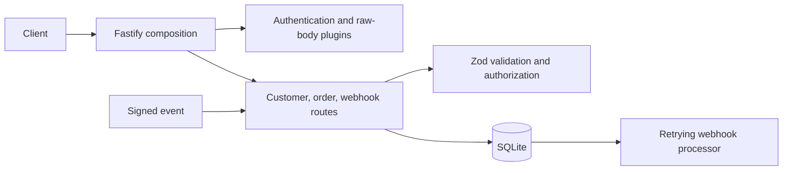

# Integration Gateway API

واجهة خلفية مستقلة بـ TypeScript وFastify لإدارة العملاء والطلبات واستقبال إشعارات دفع موقّعة. تستخدم SQLite للتخزين، وZod للتحقق وقت التشغيل، وOpenAPI لتوثيق واجهة REST. لا توجد واجهة أمامية ولا اتصال فعلي بمزود دفع؛ أحداث الدفع محاكاة محلية.

## المتطلبات والتشغيل

استخدم Node.js 22 أو أحدث وnpm. ثبّت الاعتماديات من ملف القفل وأنشئ ملف البيئة:

```powershell
npm ci
Copy-Item .env.example .env
```

عدّل القيم السرية في `.env`، ثم شغّل وضع التطوير:

```powershell
npm run dev
```

القيم الافتراضية للعنوان والمنفذ هي `127.0.0.1:3000`. لإنشاء نسخة الإنتاج وتشغيلها:

```powershell
npm run build
npm start
```

يتحقق التطبيق من البيئة قبل بدء التشغيل. أنشئ قيمًا عشوائية مستقلة لـ `ADMIN_API_TOKEN` و`CUSTOMER_API_TOKEN` و`WEBHOOK_SECRET` بطول 24 محرفًا على الأقل. لا تحفظ ملف `.env` في Git.

## إعداد البيئة

| المتغير                     | الاستخدام والقيمة الافتراضية                              |
| --------------------------- | --------------------------------------------------------- |
| `NODE_ENV`                  | `development` أو `test` أو `production`                   |
| `HOST`                      | عنوان الربط؛ الافتراضي `127.0.0.1`                        |
| `PORT`                      | المنفذ؛ الافتراضي `3000`                                  |
| `DATABASE_PATH`             | ملف SQLite؛ الافتراضي `./data/integration-gateway.sqlite` |
| `ADMIN_API_TOKEN`           | رمز الإدارة التجريبي؛ مطلوب                               |
| `CUSTOMER_API_TOKEN`        | رمز العميل التجريبي؛ مطلوب                                |
| `WEBHOOK_SECRET`            | سر HMAC؛ مطلوب                                            |
| `WEBHOOK_TOLERANCE_SECONDS` | حد عمر التوقيع؛ الافتراضي 300 ثانية                       |
| `WEBHOOK_MAX_ATTEMPTS`      | أقصى عدد محاولات المعالجة؛ الافتراضي 5                    |
| `RATE_LIMIT_MAX`            | أقصى طلبات ضمن النافذة؛ الافتراضي 100                     |
| `RATE_LIMIT_WINDOW`         | نافذة تحديد المعدل؛ الافتراضي `1 minute`                  |

## بنية المشروع

`src/app.ts` نقطة تركيب Fastify: تسجل الإضافات، وحدات المسارات، معالج الأحداث، ومهام الإغلاق. يحتوي كل من العملاء والطلبات والويب هوك على مجلد مستقل للمسارات والمخططات، مع فصل التحقق والتسلسل والأمان في وحدات مشتركة. يشرح [دليل البنية](docs/ARCHITECTURE.md) تدفق الطلب والتبعيات بالتفصيل، ويشرح [دليل الملفات](docs/FILE_GUIDE.md) وظيفة كل ملف وطريقة توسيعه.



## واجهة API والتوثيق

بعد التشغيل افتح Swagger UI على [http://127.0.0.1:3000/documentation](http://127.0.0.1:3000/documentation)، أو عقد OpenAPI على [http://127.0.0.1:3000/openapi.json](http://127.0.0.1:3000/openapi.json).

| الطريقة            | المسار                      | الوصول                                    |
| ------------------ | --------------------------- | ----------------------------------------- |
| GET                | `/health`                   | عام                                       |
| GET, POST          | `/api/v1/customers`         | رمز صالح                                  |
| GET, PATCH, DELETE | `/api/v1/customers/:id`     | المالك أو الإدارة؛ الحذف للإدارة          |
| GET, POST          | `/api/v1/orders`            | رمز صالح؛ الإنشاء يتطلب `Idempotency-Key` |
| GET, PATCH         | `/api/v1/orders/:id`        | المالك أو الإدارة                         |
| POST               | `/api/v1/webhooks/payments` | توقيع HMAC صالح                           |

يُرسل العميل رمز المصادقة في `Authorization: Bearer <token>`. الرمز الإداري يطابق `ADMIN_API_TOKEN`، ورمز العميل يطابق `CUSTOMER_API_TOKEN`. الهوية والدور مصدرهما إعدادات الخادم فقط. هذه آلية عرض توضيحي برمزين ثابتين؛ استبدلها بمزود هوية وإدارة جلسات وتدوير وإلغاء الرموز قبل النشر.

قوائم الموارد تدعم `limit` (1–100، الافتراضي 20)، و`offset` (0–100000)، وفرزًا من قائمة حقول محددة. الاستجابة الناجحة تستخدم `data` و`meta` للقوائم. تستخدم الأخطاء غلافًا موحدًا `error.code` و`error.message` و`error.requestId`، مع `fields` لأخطاء التحقق. يرسل الخادم أيضًا `x-request-id`.

## الطلبات ومنع التكرار

يرتبط إنشاء الطلب بعميل يملكه principal الحالي، ويُحفظ الطلب ورد الإعادة ومفتاح منع التكرار ضمن معاملة SQLite واحدة. أرسل `Idempotency-Key` بطول 8 إلى 128 محرفًا. إعادة الطلب بالمفتاح والحمولة نفسيهما تعيد الاستجابة الأصلية؛ استعمال المفتاح مع حمولة أخرى يعيد `409 IDEMPOTENCY_CONFLICT`. لا تنتهي صلاحية المفاتيح تلقائيًا حاليًا.

## التوقيع ومعالجة الويب هوك

نموذج الحدث المقبول هو:

```json
{
  "id": "evt_123",
  "type": "payment.status_changed",
  "data": { "orderId": "<uuid>", "status": "paid" }
}
```

وقّع **بايتات الجسم الأصلية** باستخدام HMAC-SHA256 على النص `<timestamp>.<rawBody>`. أرسل الوقت كـ Unix seconds في `X-Webhook-Timestamp`، والتوقيع hex صغير الأحرف بصيغة `X-Webhook-Signature: sha256=<hex>`. يفحص الخادم الوقت والتوقيع قبل التحقق من مخطط الحدث، ويقارن التوقيع مقارنة ثابتة الزمن.

لتوليد توقيع وطباعته محليًا:

```powershell
npm run webhook:sign -- '{"id":"evt_123","type":"payment.status_changed","data":{"orderId":"<uuid>","status":"paid"}}'
```

أرسل الجسم المطبوع نفسه والرأسين اللذين أعادهما البرنامج. يحفظ المستقبل الحدث في SQLite قبل الاستجابة `202`. تمنع قيمة `event_id` المكررة إنشاء عمل جديد. يعالج عامل داخل العملية الأحداث مع إعادة محاولات متزايدة التأخير وحد أقصى، ثم يضع المستنفد منها في `dead_letter`. يحتفظ SQLite بالأحداث بين إعادة التشغيل؛ أما مجدول العامل فداخل العملية ولا ينسق بين النسخ المتعددة. راجع [دليل تشغيل الويب هوك](docs/webhook-runbook.md).

## الاختبارات والفحوص

الأوامر المتاحة في `package.json`:

| الأمر                                     | الوظيفة                       |
| ----------------------------------------- | ----------------------------- |
| `npm run dev`                             | تشغيل التطوير عبر tsx         |
| `npm start`                               | تشغيل `dist/src/server.js`    |
| `npm run build`                           | بناء TypeScript للإنتاج       |
| `npm run typecheck`                       | فحص الأنواع دون توليد ملفات   |
| `npm run lint`                            | ESLint على المصدر والاختبارات |
| `npm run format` / `npm run format:check` | تنسيق الملفات / فحص التنسيق   |
| `npm test` / `npm run test:watch`         | اختبارات Vitest               |
| `npm run webhook:sign -- '<JSON>'`        | إنشاء توقيع اختبار            |

قاعدة الاختبار معزولة في الذاكرة، وتستخدم الاختبارات `app.inject` لتشغيل دورة Fastify دون الحاجة إلى خادم أو بيانات خارجية.

## التخزين والأمان والحدود

تُنشأ جداول SQLite تلقائيًا. تعيش بيانات العملاء والطلبات ومفاتيح منع التكرار والأحداث عبر إعادة التشغيل الاعتيادية. يستخدم حد الجسم 1 MiB وتحديد معدل داخل كل عملية. سجلات الطلب تخفي ترويسة bearer وتوقيع الويب هوك، ولا تعيد الأخطاء مكدس الاستدعاءات.

الحماية من الكائنات غير المملوكة تعتمد على principal الخادمي واستعلامات SQL المقيدة بالمالك؛ المعرّف الذي يرسله المستخدم لا يحدد الصلاحية. الترتيب يستخدم قائمة أعمدة مسموح بها فقط، والاستعلامات ذات المعاملات تستخدم معاملات SQLite.

الرموز ثابتة وتوضيحية، وتحديد المعدل والعامل محليان للعملية، ولا توجد إدارة مفاتيح متزامنة أو مزود دفع حقيقي أو مقاييس/تنبيهات أو نسخ احتياطية تلقائية. لا تشغّل عدة نسخ على قاعدة واحدة قبل إضافة حجز موزع/طابور دائم ومراجعة التشغيل. راجع [مراجعة الأمان](docs/security-review.md) لمخاطر OWASP API المتبقية.
