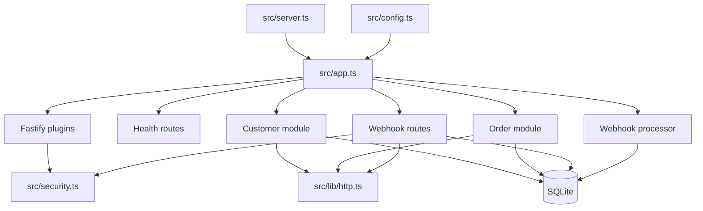

# معمارية Integration Gateway API

## الحدود والمسؤوليات

التطبيق واجهة REST مستقلة. لا توجد واجهة أمامية أو استدعاءات إلى مزود دفع. يحتفظ SQLite بالعملاء والطلبات ومفاتيح منع التكرار وأحداث الويب هوك.

| الوحدة                          | المسؤولية                                                                                                                  |
| ------------------------------- | -------------------------------------------------------------------------------------------------------------------------- |
| `src/app.ts`                    | نقطة تركيب Fastify؛ إنشاء قاعدة البيانات وتسجيل الإضافات والوحدات والعامل وإغلاق الموارد. لا تحتوي قواعد العملاء والطلبات. |
| `src/server.ts`                 | قراءة الإعدادات وبدء الاستماع والاستجابة لإشارات الإيقاف.                                                                  |
| `src/config.ts`                 | قراءة متغيرات البيئة والتحقق منها عبر Zod قبل تشغيل الخادم.                                                                |
| `src/database.ts`               | إنشاء اتصال SQLite والجداول والفهارس.                                                                                      |
| `src/plugins/authentication.ts` | تحويل رموز العرض المهيأة إلى principal على الطلب.                                                                          |
| `src/plugins/raw-json.ts`       | الاحتفاظ ببايتات JSON قبل تحليلها لاستخدامها في التوقيع.                                                                   |
| `src/lib/http.ts`               | التحقق المشترك، غلاف الخطأ، فحص principal، وربط مسارات OpenAPI.                                                            |
| `src/lib/errors.ts`             | تحويل 400 و413 والاستثناءات ومسارات 404 إلى غلاف خطأ ثابت.                                                                 |
| `src/modules/customers`         | مخططات Zod، مسارات العملاء، وتحويل صفوف SQLite إلى استجابات عامة.                                                          |
| `src/modules/orders`            | مخططات الطلبات، صلاحيات المالك، منع التكرار، وتحويل الطلبات.                                                               |
| `src/modules/webhooks`          | مخطط الحدث، التحقق والحفظ، والمعالجة الخلفية مع المحاولات.                                                                 |
| `src/security.ts`               | نوع principal ومقارنة الرموز وتوقيع HMAC.                                                                                  |

## اتجاه الاعتماد

يتجه الاعتماد من نقطة التركيب إلى الوحدات: `app.ts` يعرف Fastify وقاعدة البيانات والإعدادات ثم يمررها إلى مسارات العملاء والطلبات والويب هوك. المسارات تعتمد على أدوات HTTP والتخزين والتسلسل. المخططات لا تستورد المسارات، ومعالج الأحداث لا يستورد التطبيق. المصادقة لا تستورد وحدات الموارد. لا توجد حاجة لاستيراد `app.ts` من أي وحدة، لذلك يتجنب الرسم دورة اعتماد بين التركيب والوحدات.

## دورة الطلب في Fastify

1. ينشئ Fastify `request.id`، ثم يضيف `registerAuthentication` قيمة `x-request-id` إلى الاستجابة.
2. يطبّق `@fastify/rate-limit` الحد المحدد على العملية.
3. يقرأ محلل `application/json` الجسم بحد أقصى 1 MiB؛ يحتفظ `registerRawJsonParser` بالبايتات في `request.rawBody` ثم يحولها إلى كائن JSON للتحقق المعتاد.
4. يوجّه Fastify الطلب إلى وحدة المسار المناسبة. تضيف `addApiRoute` وصف OpenAPI مع `attachValidation` حتى تتولى مخططات Zod صياغة خطأ التحقق الموحد.
5. يتحقق المسار من principal والدور، ثم يستدعي `parse` على الجسم أو المعاملات أو الاستعلام. بيانات غير صالحة تعيد 400 وحقول الخطأ.
6. ينفذ المسار استعلام SQLite مقيدًا بالمالك أو يكتب البيانات، ثم يستخدم serializer صريحًا لإنتاج الحقول العامة.
7. تحول `registerErrorHandlers` أخطاء المحلل والحجم والمسارات غير الموجودة والاستثناءات إلى envelope آمن يحوي `requestId`.

## المصادقة والتفويض

يقرأ hook المصادقة ترويسة `Authorization: Bearer` ويقارن الرمز بتكويني الإدارة والعميل بمقارنة ثابتة الزمن عندما تتساوى الأطوال. تنشأ الهوية والدور داخل الخادم؛ لا يثق التطبيق في `userId` أو `role` من الجسم. تستخدم `requirePrincipal` للمصادقة، ويضاف دور الإدارة عند حذف عميل. تقيّد استعلامات القراءة والتعديل والحذف بمالك السجل أو دور الإدارة. يعيد المورد غير المتاح 404 لتقليل كشف وجوده. الرموز الحالية ثابتة للتجربة ولا تمثل نظام هوية إنتاجيًا.

## Zod وOpenAPI

مخطط كل مورد موجود في مجلده داخل `schemas.ts`. يتحقق المسار من `request.body` أو `request.params` أو `request.query` عبر `safeParse`. تمنع المخططات الصارمة الخصائص غير المعروفة في الأجسام، وتقيد الفرز إلى أسماء أعمدة عامة تتحول إلى أعمدة SQL ثابتة. يحتفظ تعريف Fastify بمخططات التوثيق، بينما تستخدم المسارات Zod لرسائل التحقق ومصدر الأنواع. يسجل Swagger من بيانات المسار ويعرض `/documentation` و`/openapi.json`.

## التخزين والمعاملات

يفتح `openDatabase` ملف SQLite دائمًا افتراضيًا وينشئ الجداول والفهارس عند البدء. تستخدم الاختبارات `:memory:` لعزل كل تطبيق. معاملات SQL ذات المعاملات تحمي قيم المستخدم؛ أسماء أعمدة الفرز فقط تُختار من قائمة ثابتة.

عند إنشاء طلب، يتحقق المسار أولًا من ملكية العميل. ثم تُحفظ صفوف الطلب ومفتاح idempotency والاستجابة الأصلية ضمن معاملة واحدة. إذا فشل القيد الفريد للمفتاح أثناء طلب متزامن، يقرأ المسار النتيجة الفائزة ويعيد الاستجابة أو تعارض الحمولة.

## منع تكرار الطلبات

المفتاح مطلوب بطول 8–128 محرفًا ويخزن مع principal. يحسب SHA-256 لبنية Zod بعد تطبيق القيم الافتراضية والتطبيع. إعادة المفتاح والبصمة نفسها تعيد `response_json` ورمزها الأصلي. إعادة المفتاح ببصمة مختلفة تعيد 409. لا توجد مدة انتهاء تلقائية أو تنظيف حاليًا؛ يبقى الصف حتى سياسة صيانة مستقبلية.

## استقبال الويب هوك والتحقق

المستقبل يتطلب `X-Webhook-Timestamp` من عشرة أرقام و`X-Webhook-Signature: sha256=<hex>`. يرفض timestamp خارج هامش `WEBHOOK_TOLERANCE_SECONDS`. يحسب `signWebhook` HMAC-SHA256 على `timestamp + "." + rawBody`. تتم المقارنة الثابتة قبل تحليل الحدث أو تخزينه. بعد نجاح التوقيع يحقق `paymentStatusEventSchema` من معرف الحدث ونوعه وبيانات الطلب. المفتاح الأساسي `event_id` يمنع حفظ تسليم مكرر.

يُدخل المستقبل الحدث في SQLite قبل إرسال 202. يستطلع العامل الصفوف `pending` أو `failed` المستحقة. يحدّث حالة الطلب وعلامة الحدث `processed` في معاملة واحدة، كي لا يقع تحديث منفصل يترك إعادة التنفيذ بعد انقطاع. الفشل يعاد بمهلة أسية حتى `WEBHOOK_MAX_ATTEMPTS` ثم يصبح `dead_letter`. تحفظ SQLite حالة الصفوف بين إعادة التشغيل، لكن المؤقت داخل العملية ولا يملك حجزًا موزعًا؛ ينبغي إضافة طابور أو lease قبل تشغيل نسخ متعددة.

## الأخطاء والمراقبة

شكل الخطأ العام هو `{ error: { code, message, fields?, requestId } }`. لا تعرض الاستجابة مكدس الاستدعاءات. سجلات الطلب تحجب ترويسات التفويض وتوقيع الويب هوك. يسجل التطبيق أخطاء الطلب غير المتوقعة وفشل تخزين الويب هوك وأخطاء استطلاع العامل. لا توجد حاليًا مقاييس أو tracing أو تنبيهات؛ أضفها قبل تشغيل الخدمة على نطاق إنتاجي.

## بدء التشغيل والإغلاق

يتحقق `config.ts` من البيئة قبل استدعاء `buildApp`. يفتح التطبيق SQLite، ويسجل الإضافات والـroutes ثم يبدأ مؤقت العامل غير المعيق. يقرأ `server.ts` `HOST` و`PORT` ويبدأ الاستماع. عند `SIGINT` أو `SIGTERM` يستدعي `app.close()` مرة واحدة؛ hook الإغلاق يوقف المؤقت ويغلق اتصال SQLite. كما يغلق التطبيق الموارد إذا فشل ربط المنفذ. اختبارات التكامل تتحقق من إغلاق قاعدة البيانات بعد الإغلاق.
