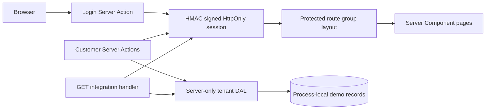

# Grids Admin Portal

A responsive, multi-tenant customer portal built on the existing Next.js App Router project. The dashboard, search/filter list, customer profiles, create/status forms, integration endpoint, and responsive shell are retained. This MVP adds a signed demo session and connected login/logout flow.

> **Demo only:** Authentication uses two documented demo email/access-code pairs and an HMAC-signed, eight-hour HttpOnly cookie. The customer store is process-local memory. Neither demo credentials nor the in-memory store are suitable for real customer data or production identity management.

## Stack and commands

- Next.js 16.4 App Router, React 19, TypeScript 5
- CSS in `src/app/globals.css`; no additional runtime packages
- Node.js 22.6+ is required for the built-in TypeScript test runner command

```bash
npm install
npm run dev
npm run lint
npm test
npm run build
npm start
```

Open [http://localhost:3000](http://localhost:3000). `npm run build` uses Next's Webpack build with one worker because the default Turbopack CSS worker and concurrent prerender workers have failed to start/create `.next` directories in this Windows sandbox.

## Demo login

In development, the server accepts these demo-only accounts:

| Role | Email | Access code |
| --- | --- | --- |
| Admin | `admin@northstar.example` | `admin-demo` |
| Viewer | `viewer@northstar.example` | `viewer-demo` |

The email maps to a server-side account record; the browser cannot submit a role or tenant. The same server-side implementation validates the submitted code, signs a session cookie, and looks up role/tenant from that account on each request. The role can’t be changed by editing page state or cookie payload. Logout clears the session cookie.

For production mode, configure all three server-only values. The app fails closed if they are missing or the session secret is shorter than 32 characters:

```text
DEMO_ADMIN_CODE=<long random admin access code>
DEMO_VIEWER_CODE=<long random viewer access code>
DEMO_SESSION_SECRET=<at least 32 random characters>
```

Each production access code must be at least 16 characters. Use independently generated random values.

Do not use the development demo codes for production. This custom demo sign-in is not a substitute for a maintained identity provider, password hashing, recovery, MFA, rotation, or account lifecycle management.

### Environment setup

Copy `.env.example` to `.env.local` for local overrides. The example intentionally contains blank values; the development-only demo codes work when these variables are absent. Production deployments must set all three values in the hosting provider's server-side environment settings. Do not add a `NEXT_PUBLIC_` prefix or commit `.env.local`.

| Variable | Required in production | Validation |
| --- | --- | --- |
| `DEMO_ADMIN_CODE` | Yes | At least 16 characters |
| `DEMO_VIEWER_CODE` | Yes | At least 16 characters |
| `DEMO_SESSION_SECRET` | Yes | At least 32 characters |

This configuration makes the demo deployable for evaluation, not suitable for production customer data. Replace the demo identity and memory store before a real deployment.

## Architecture



## App Router structure

```text
src/
  app/
    (dashboard)/layout.tsx          Session guard and shared portal shell
    (dashboard)/dashboard/page.tsx  Workspace overview
    (dashboard)/customers/page.tsx  Tenant-scoped search/filter list
    (dashboard)/customers/[id]/     Tenant-scoped profile and status action
    (dashboard)/customers/new/      Admin create form
    (dashboard)/customers/loading.tsx
    (dashboard)/customers/error.tsx
    (dashboard)/customers/[id]/not-found.tsx
    actions/auth.ts                 Login/logout Server Actions
    actions/customers.ts            Validated create/status Server Actions
    api/integration/route.ts        Admin-only example integration endpoint
    login/page.tsx                  Demo login and safe error feedback
    page.tsx                        Redirect signed-in users to dashboard, others to login
  components/
    login-form.tsx                  Server-rendered form bound to a Server Action
    create-customer-form.tsx        Interactive create validation feedback
    portal-shell.tsx                Shared responsive navigation and logout
  lib/
    auth/index.ts                   Signed cookie session and role checks
    auth/policy.ts                  Pure auth policy helpers
    data/customers.ts               Server-only data access and authorization
    data/customer-policy.ts         Tenant-scoped query helpers
    validation/customers.ts         Explicit input/status validation
tests/security.test.mjs            Node built-in session, policy, and validation tests
```

## Authentication, authorization, and routing

`src/lib/auth/index.ts` sets and verifies a payload signed with HMAC-SHA256. The cookie is `HttpOnly`, `SameSite=Lax`, `Path=/`, eight hours, and `Secure` in production. The token carries a subject and expiry only; role, name, email, and tenant come from the server-side demo account map. Invalid signatures, expired sessions, and unknown account IDs are treated as unauthenticated.

The root route sends signed-in users to the dashboard and others to `/login`. The `(dashboard)` server layout redirects unauthenticated requests to login. Next.js 16 `proxy.ts` is not used: it would only provide an early redirect, while the layout, every Server Action, the Route Handler, and the DAL independently validate access at their actual boundaries.

Server Components render the dashboard, list, detail, and shell. The login form is server-rendered and binds directly to a one-argument Server Action, so its submitted `FormData` is passed without client-side state. The create form uses a small Client Component with `useActionState` for pending and validation feedback. Server-side filtering uses `searchParams`; no client-side role or tenant state is trusted.

## Tenant isolation and data access

The server-only DAL does not accept a tenant ID argument. Each operation resolves the current signed-in user itself and scopes list, detail, create, and status operations to that user's tenant. Create and status operations also require the admin role inside the DAL, in addition to checks in their Server Actions. A URL for another tenant's customer receives the same not-found UI as an unknown ID. Another tenant is seeded to support this check.

The in-memory data is reset on restart, differs across workers/instances, and has no concurrency guarantees. Use a durable database with tenant predicates and preferably database-level row policies before production.

## Customer mutations and revalidation

Create validates field types, trimmed length, and email format on the server. Status changes validate the ID shape and status enum. The actions check the signed-in user's admin role; the DAL re-resolves the current session and enforces admin role and tenant ownership again. Successful writes revalidate the list and detail paths, and redirect to a visible success message. Invalid create fields are shown inline; unauthorized, invalid, and inaccessible status updates receive safe feedback.

## Integration endpoint

`GET /api/integration` accepts only an optional `status=active|pending|suspended`. Invalid/unknown query parameters return `400`; unauthenticated requests return `401`; viewers return `403`; unexpected failures return a generic `500`. It returns only ID, name, company, and status and sets `Cache-Control: private, no-store`. It simulates a backend-for-frontend contract; no external service is connected. A real integration should call its upstream from this server route using server-only credentials, timeouts, and safe error mapping.

## Tests and checks

`npm test` uses Node's built-in test runner and covers unauthenticated policy rejection, signed-session tampering/expiry, viewer/admin policy, tenant list/detail isolation, and invalid customer/status input. These tests exercise the pure policy functions used by the server-only boundaries; they are not a browser or real identity-provider integration suite.

## Security review checklist

### Verified for this demo MVP

- [x] Session integrity and expiry are checked on the server; the cookie is `HttpOnly`, `SameSite=Lax`, scoped to `/`, and `Secure` in production.
- [x] Role and tenant identity come from the server-side account map, never submitted form or query values.
- [x] The server-only DAL applies tenant predicates to customer list, detail, create, and status operations.
- [x] Mutations independently check authentication, admin role, input validity, and tenant ownership.
- [x] The integration endpoint authenticates, limits its projection, and disables shared caching.
- [x] Secrets are server-only and ignored environment files remain untracked; `.env.example` contains no secret values.

### Required before production use

- [ ] Replace demo codes and custom demo sessions with a maintained identity provider, secure account lifecycle, MFA, and credential rotation.
- [ ] Replace process-local records with durable storage that enforces tenant predicates, ideally with database row-level policies.
- [ ] Add rate limiting, security event/audit logging, monitoring, and a deployment-specific threat review.
- [ ] Configure and verify the deployment's HTTPS, security headers, secret manager, and session revocation strategy.

## Performance review checklist

- [x] Dashboard, customer list, details, and navigation are Server Components; client JavaScript is limited to the form state and route error interactions described below.
- [x] Tenant-specific session and customer data are not placed in a shared cache; the integration response is `private, no-store`.
- [x] Route-level loading and Suspense fallbacks keep the authenticated shell visible while request-bound content streams in.
- [x] The MVP adds no runtime dependencies or image payloads.
- [ ] Add pagination and database indexes before customer volume grows beyond the seeded demo set.
- [ ] Run load and latency checks against the real database and upstream integration before selecting cache and timeout policies.

## Short demo presentation

1. “This is a Next.js App Router portal. The protected route-group layout validates the signed session before rendering the workspace; the server-only DAL derives the tenant from that user and scopes every customer query.”
2. Sign in as `admin@northstar.example` with `admin-demo`, create a customer, open its detail page, then update its status. The Server Actions validate fields and role on the server and revalidate the affected paths.
3. Sign out and sign in as `viewer@northstar.example` with `viewer-demo`. Show that customer data remains readable but administrative mutations are unavailable and still rejected at their server boundaries.
4. Explain the Client Components: `create-customer-form.tsx` uses `useActionState` for pending and inline validation feedback; `customers/error.tsx` is a Next.js error boundary because its retry button calls the framework-provided `reset` function. Login and the customer pages remain Server Components.
5. Show `/api/integration?status=active`: it is an authenticated example contract with a minimal response, not a connected external service. Finish by noting that authentication and the in-memory data store are demo-only.

## Manual end-to-end checks

1. Start `npm run dev`, open `/`, and confirm a signed-out browser is sent to `/login`.
2. Sign in with the admin demo account, create a customer, open its profile, and update its status. Confirm the success messages and refreshed list/profile values.
3. Click **Sign out**, then open `/dashboard` directly and confirm the server redirects to login.
4. Sign in with the viewer account. Confirm dashboard/list/detail work while create/status controls are unavailable. Visit `/customers/new` directly to see the read-only message.
5. While signed in, visit `/customers/cus_2001`; it should show not found because that seeded record belongs to another tenant.
6. Visit `/api/integration?status=active`: admin should receive `200`, viewer `403`, signed-out user `401`, and invalid status `400`.

## Production limitations

- Demo login codes and account records are static demo identities; replace them with a maintained identity provider and secure account lifecycle.
- Configure server-only access codes and a strong session secret in production; never add `NEXT_PUBLIC_` prefixes.
- The process-local customer array is demonstration-only and nonpersistent.
- The integration endpoint is not connected to an external service.
- Add durable storage, audit logging, rate limits, monitoring, pagination, and a deployment-specific security review before production use.
