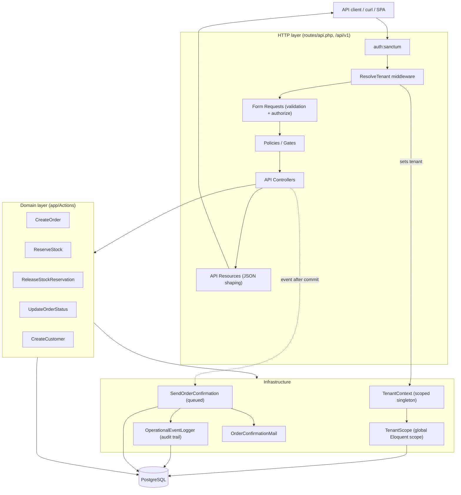
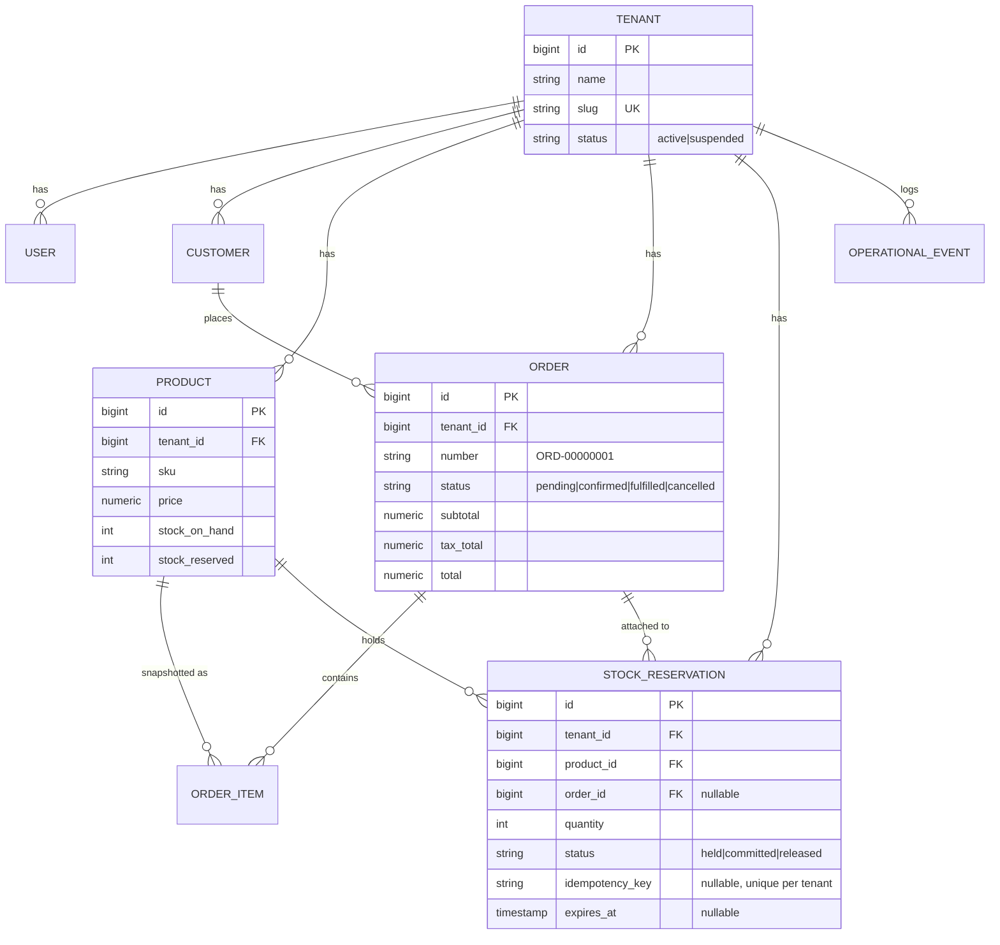

# Laravel Operations API

A standalone, multi-tenant REST API for a small operations/ERP domain: customers,
products, orders and stock reservations. Built on **Laravel 13**, **PostgreSQL**
and **Laravel Sanctum** (bearer tokens).

The API is deliberately opinionated about three things:

1. **The client never chooses its tenant.** There is no `tenant_id` input anywhere.
   The tenant is derived from the authenticated user and enforced on every read and
   write by a global Eloquent scope and by policies.
2. **Money is never trusted from the client.** Order totals are recomputed from the
   prices stored in the database, inside a transaction.
3. **Stock is never oversold.** Reservations take a row lock and re-check
   availability before writing, with a database `CHECK` constraint as backstop.

---

## Table of contents

- [Requirements](#requirements)
- [Architecture](#architecture)
- [Domain model](#domain-model)
- [Installation](#installation)
- [Database setup](#database-setup)
- [Authentication](#authentication)
- [Endpoints](#endpoints)
- [Example requests](#example-requests)
- [Transaction & concurrency strategy](#transaction--concurrency-strategy)
- [Queue setup](#queue-setup)
- [Testing](#testing)
- [Security checklist](#security-checklist)
- [Performance checklist](#performance-checklist)
- [Known limitations](#known-limitations)

---

## Requirements

| Dependency | Version used |
| --- | --- |
| PHP | 8.3+ (developed against 8.3.14) |
| Composer | 2.x |
| PostgreSQL | 14+ (developed against 18) |
| Laravel | 13.17 |
| PHPUnit | 12.5 |

> The test suite runs against a **real PostgreSQL** connection, not SQLite. The
> concurrency test in particular depends on `SELECT ... FOR UPDATE` and on
> `CHECK` constraints, neither of which SQLite provides faithfully.

## Architecture



Request lifecycle:

1. `auth:sanctum` authenticates the bearer token.
2. `ResolveTenant` loads the token owner's tenant, refuses a suspended tenant with
   `403`, and publishes it on `TenantContext`. It is pinned *before*
   `SubstituteBindings`, so route model binding is already tenant scoped.
3. The Form Request validates input and calls the matching policy.
4. The controller delegates to an Action; the Action owns the transaction.
5. An API Resource serialises the result (money as fixed-scale strings).

## Domain model



Key invariants enforced by the database (not only by PHP):

- `products.sku` is unique **per tenant**; `customers.email` is unique **per tenant**.
- `products_stock_invariants`: `stock_reserved <= stock_on_hand` and both `>= 0`.
- `stock_reservations` unique index on `(tenant_id, idempotency_key)`.
- Money columns use `numeric(12,2)`; there is no floating point anywhere.

## Installation

```sh
git clone <this-repo> laravel-operations-api
cd laravel-operations-api

composer install
cp .env.example .env
php artisan key:generate
```

Edit `.env` and point the `DB_*` values at your PostgreSQL instance, then see
[Database setup](#database-setup).

## Database setup

Create a role and two databases (one for development, one for the test suite):

```sh
psql -U postgres -c "CREATE ROLE grids_app LOGIN PASSWORD 'grids_app_dev_pw';"
psql -U postgres -c "CREATE DATABASE grids_app      OWNER grids_app;"
psql -U postgres -c "CREATE DATABASE grids_app_test OWNER grids_app;"
```

Configure `.env` (`.env.example` ships safe placeholders):

```dotenv
DB_CONNECTION=pgsql
DB_HOST=127.0.0.1
DB_PORT=5432
DB_DATABASE=grids_app
DB_USERNAME=grids_app
DB_PASSWORD=grids_app_dev_pw

DB_TEST_DATABASE=grids_app_test
QUEUE_CONNECTION=database
ORDER_TAX_RATE=0.00
```

Migrate and seed the two demo tenants:

```sh
php artisan migrate --seed
```

Seeded data (`password` is the password for every user):

| Tenant | Slug | Users (all roles) | Catalog |
| --- | --- | --- | --- |
| Acme Industrial | `acme-industrial` | `owner@acme.test`, `admin@acme.test`, `member@acme.test` | WIDGET-100, WIDGET-200, BOLT-M8, PUMP-XL |
| Globex Supply | `globex-supply` | `owner@globex.test`, `admin@globex.test`, `member@globex.test` | same SKUs, separate rows |

The two tenants own separate copies of the catalog, which is what makes the
tenant-isolation checks below observable: the same SKU has different ids per tenant.

## Authentication

The API uses Sanctum **personal access tokens** as bearer tokens. Sessions are not
used (`SESSION_DRIVER=array`).

### Issue a token over HTTP

```sh
curl -s -X POST http://localhost:8000/api/v1/auth/token \
  -H "Accept: application/json" \
  -H "Content-Type: application/json" \
  -d '{"email":"owner@acme.test","password":"password","device_name":"curl"}'
```

```json
{
  "data": {
    "token": "1|xxxxxxxxxxxxxxxxxxxxxxxxxxxxxxxxxxxxxxxx",
    "token_type": "Bearer",
    "user": { "id": 1, "name": "Owner Acme Industrial", "email": "owner@acme.test", "role": "owner" }
  }
}
```

The endpoint is rate limited to **6 requests per minute** per IP and always answers
with one generic message on bad credentials, so it cannot be used to probe which
emails exist.

### Issue a token from the CLI (development helper)

```sh
php artisan grids:issue-token owner@acme.test
```

### Use the token

```sh
curl -s http://localhost:8000/api/v1/auth/me \
  -H "Accept: application/json" \
  -H "Authorization: Bearer <token>"
```

Revoke only the current token with `DELETE /api/v1/auth/token` (other devices stay
signed in).

### Roles

A role is always evaluated **inside** the user's own tenant; no role can reach
another tenant's data.

| Role | Read | Create/update customers & products | Create orders | Order lifecycle (update) | Release reservations |
| --- | --- | --- | --- | --- | --- |
| `owner` | ✅ | ✅ | ✅ | ✅ | ✅ |
| `admin` | ✅ | ✅ | ✅ | ✅ | ✅ |
| `member` | ✅ | ❌ | ✅ | ❌ | ❌ |

## Endpoints

All endpoints are JSON, live under `/api/v1`, and require a token except where
noted. Cross-tenant resources return **`404`** (existence is never leaked);
invalid input returns **`422`**; business-rule conflicts return **`409`**.

| Method | URI | Auth | Description |
| --- | --- | --- | --- |
| POST | `/api/v1/auth/token` | public | Issue a bearer token (rate limited). |
| GET | `/api/v1/auth/me` | 🔒 | The authenticated user and their tenant. |
| DELETE | `/api/v1/auth/token` | 🔒 | Revoke the current token. |
| GET | `/api/v1/tenant` | 🔒 | The tenant the token belongs to. |
| GET | `/api/v1/customers` | 🔒 | Paginated customers (filter `status`, `search`). |
| POST | `/api/v1/customers` | 🔒 owner/admin | Create a customer. |
| GET | `/api/v1/customers/{customer}` | 🔒 | Show a customer. |
| PUT/PATCH | `/api/v1/customers/{customer}` | 🔒 owner/admin | Update a customer. |
| GET | `/api/v1/products` | 🔒 | Paginated products (`is_active`, `search`, `min_price`, `max_price`). |
| POST | `/api/v1/products` | 🔒 owner/admin | Create a product. |
| GET | `/api/v1/products/{product}` | 🔒 | Show a product (includes `stock_available`). |
| PUT/PATCH | `/api/v1/products/{product}` | 🔒 owner/admin | Update a product. |
| GET | `/api/v1/orders` | 🔒 | Paginated orders (`status`, `customer_id`, `placed_from`, `placed_until`). |
| POST | `/api/v1/orders` | 🔒 | Create an order (reserves stock, computes totals). |
| GET | `/api/v1/orders/{order}` | 🔒 | Show an order with items, customer and reservations. |
| PUT/PATCH | `/api/v1/orders/{order}` | 🔒 owner/admin | Transition order status (state machine). |
| GET | `/api/v1/stock-reservations` | 🔒 | Paginated holds (`status`, `product_id`, `order_id`). |
| POST | `/api/v1/stock-reservations` | 🔒 | Hold stock for a product (idempotency-key aware). |
| DELETE | `/api/v1/stock-reservations/{stockReservation}` | 🔒 owner/admin | Release a hold. |

Shared collection query parameters: `page`, `per_page` (max `100`), `sort` (an
allow-listed column) and `direction` (`asc`/`desc`).

## Example requests

Set a token first:

```sh
TOKEN=$(curl -s -X POST http://localhost:8000/api/v1/auth/token \
  -H "Accept: application/json" -H "Content-Type: application/json" \
  -d '{"email":"owner@acme.test","password":"password"}' \
  | php -r '$j=json_decode(stream_get_contents(STDIN),true); echo $j["data"]["token"];')
```

### Create a product

```sh
curl -s -X POST http://localhost:8000/api/v1/products \
  -H "Accept: application/json" -H "Authorization: Bearer $TOKEN" \
  -H "Content-Type: application/json" \
  -d '{"sku":"GEAR-9","name":"Gear 9","price":"12.50","stock_on_hand":10}'
```

### Create an order

`customer_id` / `product_id` are ids from the caller's tenant. No prices are sent:
they are read from the database.

```sh
curl -s -X POST http://localhost:8000/api/v1/orders \
  -H "Accept: application/json" -H "Authorization: Bearer $TOKEN" \
  -H "Content-Type: application/json" \
  -d '{
        "customer_id": 1,
        "items": [
          {"product_id": 1, "quantity": 2},
          {"product_id": 2, "quantity": 1}
        ],
        "notes": "ship asap"
      }'
```

Response (abridged):

```json
{
  "data": {
    "id": 1,
    "number": "ORD-00000001",
    "status": "pending",
    "currency": "USD",
    "subtotal": "89.48",
    "tax_total": "0.00",
    "total": "89.48",
    "items": [
      { "product_sku": "WIDGET-100", "unit_price": "19.99", "quantity": 2, "line_total": "39.98" },
      { "product_sku": "WIDGET-200", "unit_price": "49.50", "quantity": 1, "line_total": "49.50" }
    ]
  }
}
```

### Transition an order

```sh
curl -s -X PATCH http://localhost:8000/api/v1/orders/1 \
  -H "Accept: application/json" -H "Authorization: Bearer $TOKEN" \
  -H "Content-Type: application/json" \
  -d '{"status":"confirmed"}'
```

Illegal transitions (e.g. `fulfilled → pending`) return `409` with a JSON body.

### Reserve stock (idempotent)

```sh
curl -s -X POST http://localhost:8000/api/v1/stock-reservations \
  -H "Accept: application/json" -H "Authorization: Bearer $TOKEN" \
  -H "Idempotency-Key: hold-2026-10-17-001" \
  -H "Content-Type: application/json" \
  -d '{"product_id":1,"quantity":5}'
```

The first call returns `201`. Replaying the **same** `Idempotency-Key` returns
`200` with the original reservation and does **not** hold a second time. Requesting
more than the available quantity returns `409`.

## Transaction & concurrency strategy

### Orders are all-or-nothing

`App\Actions\CreateOrder` wraps the entire creation in a single `DB::transaction`:

1. Resolve the customer **through the tenant scope** (a foreign tenant's customer is
   not found → `422`).
2. Lock every requested product row up front, ordered by `id`, with
   `SELECT ... FOR UPDATE`. Locking in a deterministic order removes the deadlock
   that two concurrent multi-line orders would otherwise hit.
3. Reject unknown or inactive products.
4. For each line, reserve stock (`ReserveStock`) and snapshot the price/name/sku into
   `order_items`.
5. Compute `subtotal`, `tax_total` and `total` with `bcmath` from the **trusted**
   database prices (no floats).
6. Record the audit event, then commit.

If any step throws, the whole transaction rolls back: no partially created order,
no orphan reservation, no stock left held.

### Notifications only fire for committed orders

`OrderCreated` is dispatched **after** `DB::transaction` returns. A rolled-back
order can therefore never enqueue a confirmation email.

### Stock reservations cannot oversell

`App\Actions\ReserveStock`:

- Reads the product with `SELECT ... FOR UPDATE`, so two concurrent reservations for
  the same product serialise on the row instead of both reading the same availability.
- Re-checks `available = stock_on_hand - stock_reserved` **after** the lock is held
  and before writing.
- Writes the stock update, the reservation row and the audit event in one transaction.
- Is protected by the `products_stock_invariants` `CHECK` constraint as a final,
  database-level backstop.

### Replay safety

Queue delivery and network retries are at-least-once, so mutations must be
replay-safe:

- **Reservations** accept an `Idempotency-Key` header (or `idempotency_key` body
  field). `(tenant_id, idempotency_key)` is unique, so a retry returns the original
  reservation. Losing the insert race is handled explicitly by re-reading the winner.
- **Notifications** are guarded twice: `ShouldBeUnique` (a cache lock keyed by order
  id) prevents concurrent duplicate runs, and the job checks the operational log for a
  prior `order.notification_sent` event before sending, so a retry after a partial
  failure does not send twice.

### Order lifecycle & inventory

| Target status | Inventory effect |
| --- | --- |
| `pending → confirmed` | Holds stay `held` (goods still in the warehouse). |
| `confirmed → fulfilled` | Holds become `committed`; `stock_on_hand` **and** `stock_reserved` both decrease in one `UPDATE`, so the `CHECK` constraint is never momentarily violated and the goods physically leave. |
| `pending/confirmed → cancelled` | Holds become `released`; `stock_reserved` decreases, returning the quantity to available stock. |

Standalone holds (created through the API without an order) carry an `expires_at`
(`STOCK_RESERVATION_TTL_MINUTES`, default 30) so a forgotten hold cannot freeze
inventory forever. Holds attached to an order live for the order's lifetime.

## Queue setup

The queue driver is a configuration choice; the code is driver-agnostic.

**Local development** uses the `database` driver, which is durable across restarts
(jobs live in the `jobs` table):

```dotenv
QUEUE_CONNECTION=database
DB_QUEUE_TABLE=jobs
DB_QUEUE_RETRY_AFTER=90
```

Run a worker (or `php artisan dev`, which runs the worker alongside the app):

```sh
php artisan queue:work --tries=3 --timeout=30
```

`SendOrderConfirmation` runs with `tries = 3`, `backoff = [10, 30, 120]`,
`timeout = 30` and `uniqueFor = 300`. Failed jobs land in `failed_jobs`; inspect
them with `php artisan queue:failed`, retry with `php artisan queue:retry all`.

**Production** should use a managed broker — Amazon SQS or Redis — so workers scale
horizontally and survive node loss:

```dotenv
QUEUE_CONNECTION=sqs      # or: redis
AWS_ACCESS_KEY_ID=...
AWS_SECRET_ACCESS_KEY=...
AWS_DEFAULT_REGION=eu-west-1
```

Order-confirmation mail is written to the log locally (`MAIL_MAILER=log`); point
`MAIL_*` at a real SMTP/API transport in production.

## Testing

The suite is **PHPUnit** and runs against a real PostgreSQL test database
(`DB_TEST_DATABASE`, default `grids_app_test`) that is migrated fresh on each run.

```sh
php artisan test
# or the focused suites:
php artisan test --testsuite=Unit
php artisan test --testsuite=Feature
php artisan test --filter=StockConcurrencyTest
```

Coverage highlights:

| Suite | What it proves |
| --- | --- |
| `tests/Feature/Api/AuthenticationTest.php` | Token issue/use/revoke, generic failure message, suspended tenant. |
| `tests/Feature/Api/CustomerApiTest.php` | CRUD, per-tenant email uniqueness, tenant isolation. |
| `tests/Feature/Api/ProductApiTest.php` | CRUD, per-tenant SKU uniqueness, validation, filtering. |
| `tests/Feature/Api/OrderApiTest.php` | Totals from DB prices, full rollback, lifecycle, notifications only after commit. |
| `tests/Feature/Api/StockReservationApiTest.php` | Holds, oversell → `409`, idempotent replay → `200`, release. |
| `tests/Feature/StockConcurrencyTest.php` | Two **real OS processes** race for the same row; the lock prevents the oversell and the replay key collapses duplicates. |
| `tests/Feature/OrderQueryPerformanceTest.php` | Constant query budgets on collection endpoints (no N+1). |
| `tests/Unit/*` | Order state machine, reservation rules, event-logger redaction. |

`StockConcurrencyTest` launches child `php artisan grids:reserve-stock` processes
(the `--delay` option makes the first hold its row lock until a marker is printed) so
the oversell guard is demonstrated against the real database rather than mocked.

**Latest run:** 92 tests, 445 assertions, all passing.

## Security checklist

- ✅ **Tenant isolation on reads and writes** — global `TenantScope` plus `ResolveTenant`
  pinned before route model binding, plus tenant-scoped policies. Cross-tenant access
  is a `404`, never a leak.
- ✅ **No client-supplied tenant id** — no request field, header or route parameter
  accepts one; the tenant comes only from the authenticated token.
- ✅ **No client-supplied prices** — totals are recomputed from `products.price`.
- ✅ **Suspended tenants are refused** at both token issue and every request (`403`).
- ✅ **Generic auth errors** — one message for unknown email and wrong password alike.
- ✅ **Token endpoint rate limited** to 6/min; **API group rate limited** via `throttleApi()`.
- ✅ **JSON-only error rendering** — unauthenticated API calls get `401` JSON, never a
  redirect to a login page.
- ✅ **Sort columns allow-listed** per endpoint, so `ORDER BY` cannot be injected.
- ✅ **Mass-assignment safe** — `tenant_id` and stock counters are not fillable; all
  writes go through `forceFill` in Actions with server-derived values.
- ✅ **Audit trail with redaction** — `OperationalEventLogger` rejects PII/secret keys
  (email, password, token, …) so the log cannot become a data-leak surface.
- ✅ **Secrets stay out of git** — `.env` is gitignored; `.env.example` holds
  placeholders only.
- ✅ **Database-enforced invariants** — `CHECK` constraints and unique indexes mean a
  bug in PHP cannot corrupt stock or create duplicate replay keys.

## Performance checklist

- ✅ **Eager loading everywhere** — collection endpoints `with()` their relations and
  select explicit columns to avoid over-fetching.
- ✅ **Constant query counts** — `OrderQueryPerformanceTest` asserts exact budgets
  (orders index = 4 queries, customers index = 2) regardless of page size.
- ✅ **Keyset-friendly pagination** — every collection is paginated with a hard cap
  (`per_page` max 100).
- ✅ **Indexes on foreign keys and hot filters** — `tenant_id`, status, order/customer
  lookups and the unique replay key are indexed in the migrations.
- ✅ **Row locks held briefly** — locks are acquired late and released on commit; the
  multi-line lock ordering bounds lock wait time.
- ✅ **Heavy work deferred** — mail rendering/sending runs in a queued job, not in the
  request cycle.
- ✅ **Deterministic money** — `numeric(12,2)` + `bcmath` avoids float drift and the
  re-serialisation cost of normalising imprecise values.

## Known limitations

- **No composite tenant foreign keys.** `order_items.product_id` etc. are plain FKs;
  isolation is enforced by the query scope and by Actions validating membership. A
  composite `(tenant_id, id)` foreign key would make it impossible at the database
  level and is the recommended next hardening step.
- **No automated expiry sweeper.** Standalone holds carry `expires_at`, but a scheduled
  job to release expired holds is not included (a `ReleaseExpiredReservations` command
  on the scheduler would be the natural addition).
- **No currency conversion.** Orders require a single currency across their lines, but
  there is no FX layer.
- **Queue is single-node by default.** The `database` driver is fine for local
  development; horizontal scaling needs SQS/Redis (documented above).
- **No pagination cursors.** Offset pagination only; very deep pages degrade on large
  tables.
- **No refresh tokens / OAuth.** Sanctum personal access tokens only; expiry and
  rotation policies are left to the deployment.
- **Laravel Boost was intentionally not installed**, so `AGENTS.md` retains the
  stock Laravel guidance rather than generated, project-specific guidance.
```
