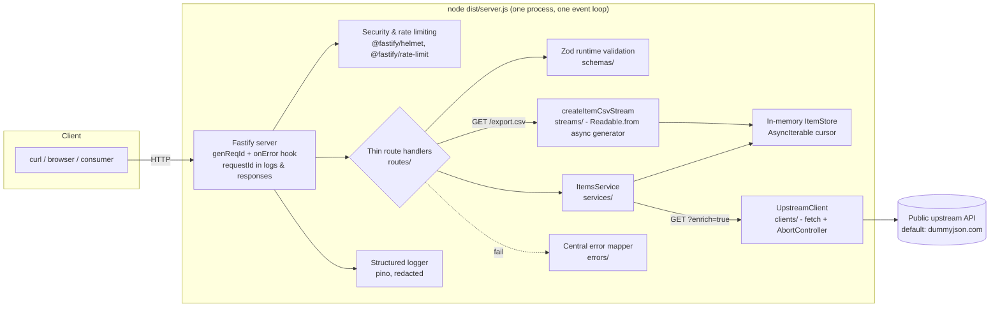
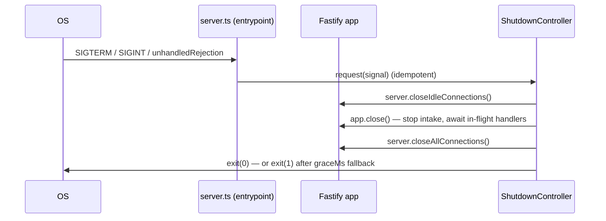
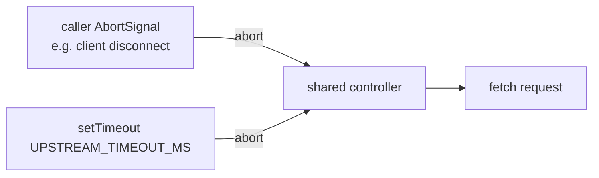

# Node Integration Service

GRIDS APPS — Advanced Full Stack Web Development project.
A standalone **Node.js 22 LTS + TypeScript (strict, ESM) backend** built with **Fastify**, demonstrating:

- thin-route REST API architecture with runtime validation (Zod),
- a real outbound integration client (global `fetch` + `AbortController` timeouts),
- streaming CSV export with true backpressure (no in-memory build-up),
- a typed error model with a central error-to-HTTP mapper,
- structured logging with request IDs and redaction,
- bounded readiness checks and liveness endpoints,
- controlled graceful shutdown,
- a fully offline-friendly automated test suite built on `node:test`.

Runtime details verified on **Node v22.16.0** (npm 11) on Windows.

---

## Table of contents

1. [Architecture](#architecture)
2. [Installation & startup](#installation--startup)
3. [Environment configuration](#environment-configuration)
4. [API reference & curl examples](#api-reference--curl-examples)
5. [Error response format](#error-response-format)
6. [External integration design](#external-integration-design)
7. [Timeout & cancellation behavior](#timeout--cancellation-behavior)
8. [Event loop: I/O-bound vs CPU-bound work](#event-loop-io-bound-vs-cpu-bound-work)
9. [Streams & backpressure (CSV export)](#streams--backpressure-csv-export)
10. [Graceful shutdown](#graceful-shutdown)
11. [Testing](#testing)
12. [Security checklist](#security-checklist)
13. [Known limitations](#known-limitations)

---

## Architecture



Process-level composition (kept out of application code so tests can build the app without listening):



**Layering rules**

| Concern                                   | Location                                        | Never does                   |
| ----------------------------------------- | ----------------------------------------------- | ---------------------------- |
| Startup/shutdown orchestration            | `src/server.ts`, `src/runtime/shutdown.ts`      | Business logic               |
| App construction (routes, plugins, hooks) | `src/app.ts`                                    | Listen, handle signals       |
| HTTP routing (thin)                       | `src/routes/`                                   | Direct env access, raw fetch |
| Validation                                | `src/schemas/` (Zod)                            | HTTP concerns                |
| Business logic                            | `src/services/`                                 | Know HTTP status codes       |
| Outbound HTTP                             | `src/clients/upstream-client.ts`                | Trust upstream payloads      |
| Error model & mapping                     | `src/errors/app-errors.ts`                      | Expose stacks/details        |
| Logging                                   | `src/logging/create-logger.ts`                  | Log secrets                  |
| Streaming                                 | `src/streams/csv-stream.ts`                     | Build full files in memory   |
| Configuration                             | `src/config/env.ts` (only `process.env` reader) | —                            |

---

## Installation & startup

```powershell
# requires Node.js >= 22.9 (developed & verified on v22.16.0)
cd node-integration-service
npm install

# development (loads .env automatically, no build step needed)
npm run dev

# production
npm run build
npm run start          # node --env-file-if-exists=.env dist/server.js

# watch mode
npm run dev:watch
```

The service listens on `PORT` (default **3000**).

## Environment configuration

All configuration is validated once at startup by `src/config/env.ts` — no other module
calls `process.env`. Invalid values fail **fast**, before listening, with a structured
`CONFIG_INVALID` error listing every offending variable.

Safe defaults exist for every value (see `.env.example`); nothing requires credentials.

| Variable                    | Default                 | Constraints                                                        |
| --------------------------- | ----------------------- | ------------------------------------------------------------------ |
| `PORT`                      | `3000`                  | integer 0–65535                                                    |
| `HOST`                      | `0.0.0.0`               | non-empty string                                                   |
| `NODE_ENV`                  | `development`           | `development` \| `test` \| `production`                            |
| `LOG_LEVEL`                 | `info`                  | pino levels incl. `silent`                                         |
| `UPSTREAM_API_URL`          | `https://dummyjson.com` | absolute **http(s)** URL (validated)                               |
| `UPSTREAM_TIMEOUT_MS`       | `5000`                  | integer 50–60000 (hard outbound timeout)                           |
| `RATE_LIMIT_MAX`            | `240`                   | ≥1                                                                 |
| `RATE_LIMIT_WINDOW_SECONDS` | `60`                    | 1–3600                                                             |
| `SHUTDOWN_GRACE_MS`         | `10000`                 | 100–120000 (in-flight request grace period)                        |
| `READINESS_UPSTREAM_PROBE`  | `true`                  | `true`/`false`/`1`/`0`                                             |
| `READINESS_STRICT_UPSTREAM` | `false`                 | when `true`, an unreachable upstream makes `/ready` return **503** |
| `ENABLE_DEMO_BLOCK`         | `false`                 | enables the event-loop blocking demo route                         |

Secrets are never placed in config and never logged (see redaction below).

## API reference & curl examples

All JSON is wrapped in envelopes: single resources as `{ "data": ... }`,
lists as `{ "data": [...], "meta": { limit, offset, total } }`.
Every response carries an `x-request-id` header.

### Health & readiness

```bash
curl http://localhost:3000/health
# {"status":"ok","env":"development","uptimeSeconds":14}
```

`/health` = _liveness_ — pure process check, zero I/O, always 200 while the process can answer.

```bash
curl http://localhost:3000/ready
```

`/ready` = _readiness_ with **bounded** checks only:

- `event-loop` — measures one tick of loop scheduling lag;
- `in-memory-store` — trivially reachable (plain `Map` in this process);
- `upstream` — ONE cached HEAD probe (1.5 s timeout, 10 s TTL cache) against
  `UPSTREAM_API_URL`; any HTTP status counts as "reachable".

Readiness returns **503** only when a check is _failing_ (e.g. strict mode with
unreachable upstream). A degraded upstream otherwise degrades the report but still
answers 200 — honest, non-brittle behavior documented above.

### Items

```bash
# list with pagination + filter
curl 'http://localhost:3000/api/v1/items?limit=5&offset=10&category=home'

# single item
curl http://localhost:3000/api/v1/items/itm_1

# single item enriched with upstream data (integration call!)
curl 'http://localhost:3000/api/v1/items/itm_1?enrich=true'

# create (price is a whole number of cents: 2490 == $24.90)
curl -X POST http://localhost:3000/api/v1/items \
  -H 'content-type: application/json' \
  -d '{"name":"Copper Wire Spool","category":"electronics","price":2490,"description":"50m"}'
# -> 201 Created, Location: /api/v1/items/itm_1000
```

Item fields: `id`, `name`, `description`, `category`, `price` (non-negative **integer
in minor units / cents** — `2490` is $24.90; the CSV export formats it with two
decimals), `createdAt`, `updatedAt` (ISO 8601). Minor units avoid binary
floating-point rounding, so `POST` rejects fractional prices with a validation error.
Validation errors on path/query/body return `400 VALIDATION_ERROR` with per-field issues.

### Upstream integration proxy

```bash
curl http://localhost:3000/api/v1/integrations/quote
# {"data":{"quote":"...","author":"...","fetchedAt":"2026-10-17T16:36:56.185Z"}}
```

Fails honest and structured: `502 UPSTREAM_*` or `504 UPSTREAM_TIMEOUT` when the
upstream misbehaves.

### CSV export

```bash
curl -o items-export.csv http://localhost:3000/api/v1/export.csv
```

`Content-Type: text/csv; charset=utf-8`,
`Content-Disposition: attachment; filename="items-export.csv"`, streamed chunked
(never a prebuilt string).

## Error response format

```json
{
  "code": "VALIDATION_ERROR",
  "message": "Request validation failed.",
  "requestId": "1ba547b4-60c0-43dd-acfd-a1da4c1a1745",
  "errors": [{ "path": "query.limit", "message": "Expected number, received nan" }]
}
```

| `code`                       | HTTP    | Meaning                                                              |
| ---------------------------- | ------- | -------------------------------------------------------------------- |
| `VALIDATION_ERROR`           | 400     | path/query/body failed Zod validation (`errors` populated)           |
| `NOT_FOUND`                  | 404     | unknown item or unknown route                                        |
| `UNAUTHORIZED` / `FORBIDDEN` | 401/403 | reserved for protected routes (typed errors exist)                   |
| `RATE_LIMITED`               | 429     | too many requests (`retry-after` header included)                    |
| `SERVICE_UNAVAILABLE`        | 503     | readiness-gated dependency missing                                   |
| `UPSTREAM_TIMEOUT`           | 504     | upstream didn't respond within `UPSTREAM_TIMEOUT_MS` (incl. aborted) |
| `UPSTREAM_NETWORK_ERROR`     | 502     | socket/DNS failure reaching upstream                                 |
| `UPSTREAM_BAD_RESPONSE`      | 502     | upstream returned non-JSON or schema-invalid payload                 |
| `UPSTREAM_HTTP_ERROR`        | 502     | upstream returned non-2xx (status recorded internally only)          |
| `INTERNAL_ERROR`             | 500     | unexpected; message is generic, full details stay in logs            |

Request IDs: taken from a sane `x-request-id` header (`[A-Za-z0-9_-]{8,64}`,
trimmed) or generated via `crypto.randomUUID()`; echoed in `x-request-id`,
all logs, and all error bodies.

## External integration design

- **Client**: `src/clients/upstream-client.ts` — small `QuoteProvider` port backed by
  the global `fetch`. `UPSTREAM_API_URL` makes the base URL configurable (tests inject
  a local mock server instead of the internet).
- **Upstream**: by default `https://dummyjson.com/quotes/random` — a genuinely public,
  keyless endpoint (verified working; see curl above). **No third-party
  credentials are required**, and nothing here is mocked in production mode.
- **Validation**: upstream payloads are schema-validated (`{id, quote, author}`) and
  reduced to `{quote, author}` before any use — unknown/sensitive upstream fields
  never reach our own API responses.
- **Failure taxonomy**: timeout vs network vs bad payload vs upstream HTTP error are
  four distinct typed errors with distinct logs.
- **Safety**: upstream error bodies are drained and discarded (never forwarded),
  and the client never attaches raw upstream payloads to public responses.

## Timeout & cancellation behavior

Each outbound call owns **one** `AbortController` that serves both purposes:



```ts
const timer = setTimeout(() => controller.abort(), this.timeoutMs)
try {
  // ... fetch + parse + validate ...
} finally {
  clearTimeout(timer) // ALWAYS cleaned up — success, failure, abort
}
```

- The `finally` block clears the timeout unconditionally — no timers leak.
- Timeout and caller-cancellation both surface as `UPSTREAM_TIMEOUT` (504):
  a deliberate simplification — from the caller's perspective the request may
  still be retried after either.
- The current HTTP request's teardown is propagated into enrich/proxy calls
  (`requestCloseSignal`), so a vanished client stops its upstream work.
- Slow upstream reads count towards the same timeout (headers + body).

## Event loop: I/O-bound vs CPU-bound work

Node.js executes all request handlers on **one** event loop thread:

- **I/O-bound work** (fetch, streams, timers) is queue-tracked and async — it never
  blocks other requests. All handlers here are `async/await` with explicit `try/catch`
  bubbling to the central error handler; no sync filesystem calls exist in request paths.
- **CPU-bound work** (parsing megabytes, crypto, image processing) monopolizes the
  loop while it runs — every other request, socket event, and timer simply waits.

**Demonstration** (included):

```powershell
# 1) start with the demo route enabled
$env:ENABLE_DEMO_BLOCK = 'true'
npm run dev

# 2) in another shell:
npx tsx scripts/event-loop-demo.ts
# Proving event loop blocking against http://127.0.0.1:3000
# GET /api/v1/demo/sync-block?ms=1500 -> 1552ms (as requested)
# GET /health while blocked          -> 1425ms (BLOCKED — event loop stall demonstrated)
```

`/health` — a route with no I/O — took **~1.4 s** because the demo route spun
`while (performance.now() < deadline) {}` for 1.5 s: the loop could not run
anything else. This is why CPU-heavy work must go to a worker thread or another
process — none of this service's actual workload is CPU-heavy, and adding
worker threads here would be unjustified rather than "responsible extra work".

## Streams & backpressure (CSV export)

`GET /api/v1/export.csv` streams instead of materializing:

```
store.iterateAll() (AsyncIterable "cursor")
        │  one item at a time
        ▼
async generator (header, then one CSV line per item)
        │  Readable.from(generator) — Node pauses/waits per pull
        ▼
Fastify pipes the Readable to the HTTP response (chunked encoding)
```

- **No full-file string**: the generator yields one line at a time; the store's
  `iterateAll` is the seam where a real database cursor slots in later.
- **Real backpressure**: `Readable.from` + async generator + pipe pull each row
  only as the socket drains; a slow client slows production automatically.
- **Client disconnects**: the route binds `reply.raw.on('close')` — if the socket
  dies before the body completes, the stream is `destroy()`ed so the generator
  stops promptly (an `AbortSignal` also short-circuits the store iterator).
- **RFC 4180 escaping**: fields containing commas, quotes or line breaks are
  quoted with doubled internal quotes (data intentionally contains such values).
- **Column allow-list**: only `id,name,description,category,price,created_at`
  reach the file — new sensitive fields cannot leak without an explicit edit.
- Restart-safe: chunked transfer encoding, no `content-length` guessing.

Reproduce the stream content safely:

```bash
curl -o out.csv http://localhost:3000/api/v1/export.csv
cat out.csv | head -n 3
```

## Graceful shutdown

Implemented in `src/runtime/shutdown.ts` (and driven by `src/server.ts`):

1. **Idempotency**: `request(signal)` guards with a flag — SIGINT after SIGTERM (or
   an unhandled rejection during shutdown) is a no-op instead of double-teardown.
2. **Grace period**: a bounded fallback timer (`SHUTDOWN_GRACE_MS`, default 10 s)
   force-exits with code **1** if anything hangs (e.g. a stuck in-flight request).
3. **Intake stops**: `server.closeIdleConnections()` then `app.close()`
   (Fastify stops accepting and awaits in-flight handlers).
4. **Lingering sockets**: `server.closeAllConnections()` after close so keep-alive
   sockets cannot stall Node's exit.
5. **Owned resources**: none today beyond the HTTP server itself (upstream timeouts
   are request-scoped and already cleaned in `finally`); the controller exposes a
   `disposables` hook — honestly _not_ claimed otherwise for databases we don't have.
6. **Error handling**: any close error logs and turns into exit code 1.

Keep in mind: on Windows, SIGTERM is not reliably deliverable to child processes
(shutdown tests therefore drive the controller directly); Ctrl+C (SIGINT) works in
interactive terminals on Windows, and signals behave 1:1 on Linux/macOS.

## Testing

`node:test` + `node:assert/strict`, executed through `tsx` — **all tests run
offline** (injected fakes or `127.0.0.1` mock servers, never the real internet,
never production credentials).

```bash
npm test              # whole suite (61 tests / 11 suites at time of writing)
npm run test:unit     # unit only
npm run test:integration
```

Coverage of the rubric areas:

| Area                                                                          | Where                                                            |
| ----------------------------------------------------------------------------- | ---------------------------------------------------------------- |
| Valid requests / paging / filtering                                           | `tests/integration/api.test.ts`                                  |
| Invalid params → structured errors                                            | `api.test.ts` (query/category/path/body)                         |
| Request-ID behavior (propagation + generation)                                | `api.test.ts`                                                    |
| Upstream success / timeout / non-2xx / bad JSON / network / caller-cancel     | `tests/unit/upstream-client.test.ts`                             |
| ACK CSV output + escaping                                                     | `tests/unit/csv.test.ts`, `tests/integration/export-csv.test.ts` |
| Health & readiness (incl. 503 strict path, probe caching)                     | `tests/integration/health-readiness.test.ts`                     |
| Rate limiting (429 + health exemption)                                        | `tests/integration/rate-limit.test.ts`                           |
| Graceful shutdown (idempotency, hanging close → force exit, live server stop) | `tests/integration/shutdown.test.ts`                             |
| Config validation (URL/range/coercion/empty-string)                           | `tests/unit/config.test.ts`                                      |

## Security checklist

- [x] Security headers via `@fastify/helmet` (CSP, `x-frame-options`, HSTS, nosniff, …)
- [x] Rate limiting with `retry-after` on 429; health endpoints always available
- [x] Request-ID propagation + strict ID format check (no header passthrough of junk)
- [x] Body size limit (1 MiB) + payload/irrelevant content-type rejection (415/413 mapped)
- [x] Zod validation on path params, query params, and bodies — including unknown-key stripping
- [x] Errors never expose stack traces, causes, or internal messages (`INTERNAL_ERROR` is generic)
- [x] Upstream response bodies are never forwarded, stored, or embedded in errors
- [x] Log redaction for `authorization`, `cookie`, `x-api-key`, `proxy-authorization`
- [x] Request logging trimmed to method/url/status (no headers or bodies)
- [x] `.env` files git-ignored; only placeholders exist in `.env.example`
- [x] No credentials needed anywhere — nothing to leak

## Known limitations

1. **In-memory store** — the dataset is process-local and mock (documented seeds in
   `src/services/seed-items.ts`); a restart discards it. The `ItemStore` port +
   `iterateAll()` AsyncIterable are the seams for a real database/cursor later.
2. **Unbounded upstream exposure window** — the quote proxy passes data through a
   single hard timeout; a fully fleshed integration would add retries with backoff,
   circuit breaking, and response size caps (2 KiB read cap for peer safety).
3. **Strict readiness is opt-in** — by default a dead upstream does NOT fail
   `/ready` because core CRUD does not depend on it (see config `READINESS_STRICT_UPSTREAM`).
4. **Cancellation collapses to one error class** — caller-canceled and timed-out
   upstream requests both report `UPSTREAM_TIMEOUT`; distinguishing them would need
   a fifth error code.
5. **Windows signal limits** — SIGTERM is only partially deliverable on Windows;
   shutdown _logic_ is signal-agnostic and directly testable (see tests).
6. **No authentication** — by design out of scope; typed `UnauthorizedError` /
   `ForbiddenError` already exist for protected-route additions.
7. **No OpenAPI generation** — types come from Zod, but the OpenAPI document is
   not generated (fine for an MVP).
8. **No worker threads** — intentionally, per rubric; the demo makes the blocking
   trade-off visible instead.
